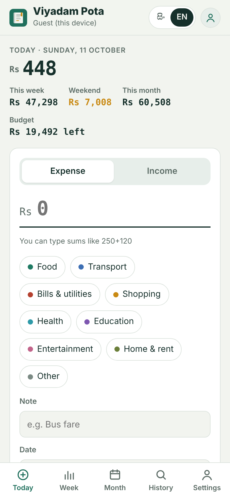
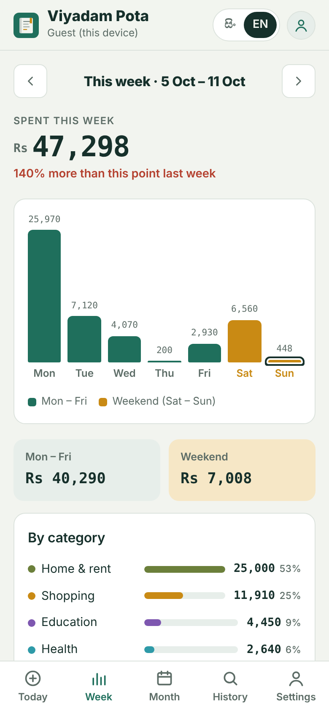
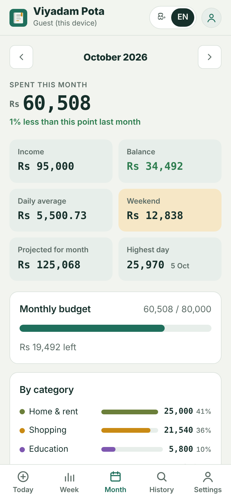
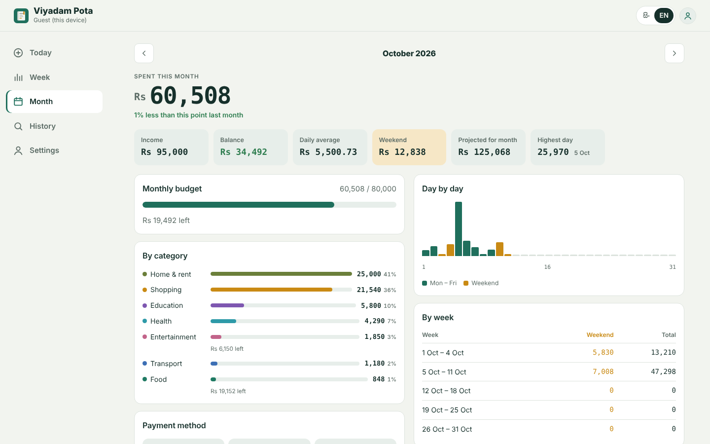

# Viyadam Pota · වියදම් පොත

A free, bilingual (**Sinhala & English**) expense tracker. Log what you spend each day, see how much went on **weekdays vs. the weekend**, and get a clear **summary at the end of every month** — on your phone or laptop, even offline.

**Live demo:** https://malingaprabhath7-maker.github.io/viyadam-pota/

<p>
  
  
  
</p>



## Features

| | |
|---|---|
| **Accounts** | Sign up with name, email and password · log in · forgot-password email · change password · profile name and photo · delete account |
| **Guest mode** | Use it without an account; entries move into your account when you sign up |
| **Income balance** | Add your salary and watch what is left for the month shrink as you spend, with a safe daily amount for the rest of the month |
| **Daily logging** | Expense or income, category, note, date and payment method (cash / card / online) · type sums like `250+120` · one-tap repeat for frequent items · edit, delete and undo |
| **Week view** | Mon–Sun chart with weekend days highlighted · weekday vs. weekend totals · comparison with the same point last week |
| **Month view** | Spending, income, balance, daily average, projection, highest day, by category, by payment method, by week, five biggest expenses, and a 12-month overview |
| **Trends** | 3, 6 or 12-month view of spending vs income, savings rate, category changes with sparklines and plain-language insights |
| **Family books** | Create a shared book, invite family with a code (or WhatsApp), everyone adds expenses and sees who added what; owner manages members |
| **Bill scanning** | Snap a receipt and the total, date, shop and category are filled in — read on the phone itself with Tesseract.js, nothing uploaded |
| **Daily reminder** | Repeating Google Calendar / .ics reminder, plus a notification and in-app nudge when nothing was logged |
| **Budgets** | Monthly limit plus per-category limits, with warnings at 80% and when you go over |
| **Repeating items** | Rent, bills or salary are added automatically on the chosen day each month |
| **Custom categories** | Add your own expense or income categories with a colour |
| **Search & history** | Filter by text, category and date range |
| **Export** | Copy a text summary · print or save the monthly report as PDF · CSV for Excel · JSON backup and restore |
| **Everywhere** | Installable PWA, works offline, light and dark themes, phone and desktop layouts |

## Tech

- Plain HTML, CSS and modern JavaScript (ES modules) — no build step, so it runs straight from GitHub Pages
- [Firebase Authentication](https://firebase.google.com/docs/auth) + [Cloud Firestore](https://firebase.google.com/docs/firestore) on the free Spark plan, with offline cache
- Security rules (`firestore.rules`) let each user read and write only their own data
- Service worker + web app manifest for offline use and "Add to Home screen"
- Unit tests with Node's built-in test runner (`npm test`)

```
index.html            app shell
css/styles.css        design tokens, light/dark, phone/desktop layouts
js/app.js             UI and events
js/calc.js            pure date & money logic (unit-tested)
js/i18n.js            Sinhala and English text
js/store.js           data shape and validation
js/backend-local.js   guest storage (localStorage)
js/cloud.js           Firebase accounts, sync and shared family books
js/receipt.js         bill photo reading and total detection (unit-tested)
js/firebase-config.js your Firebase keys (null = guest-only mode)
firestore.rules       database security rules
sw.js                 offline cache
tests/                unit tests
```

## Run locally

```bash
npm test          # run the unit tests (Node 18+)
npm start         # serve on http://localhost:5173
```

Any static server works (`python3 -m http.server`). Opening `index.html` directly from disk won't work because browsers block ES modules on `file://`.

## Set up accounts (Firebase)

Without a Firebase config the app runs in guest mode. To turn on accounts:

1. Create a project at [console.firebase.google.com](https://console.firebase.google.com) (the free Spark plan is enough).
2. **Build → Authentication → Get started → Email/Password → Enable.**
3. **Build → Firestore Database → Create database** (production mode, nearest region).
4. In **Firestore → Rules**, paste the contents of `firestore.rules` and publish.
5. **Project settings → Your apps → Web (`</>`)**, register the app and copy the `firebaseConfig` object into `js/firebase-config.js`.
6. **Authentication → Settings → Authorized domains → Add domain:** `malingaprabhath7-maker.github.io`.

The web config keys are meant to be public; the security rules are what protect the data.

## Deploy to GitHub Pages

1. Upload the project to a public repository named `viyadam-pota`.
2. **Settings → Pages → Build and deployment → Deploy from a branch → `main` / `(root)` → Save.**
3. After about a minute the site is live at `https://malingaprabhath7-maker.github.io/viyadam-pota/`.
4. Replace `malingaprabhath7-maker` in `index.html` and this README so link previews (LinkedIn, WhatsApp) show the right image.

---

## සිංහලෙන්

**වියදම් පොත** යනු දිනපතා වියදම් සටහන් කරලා, සතියේ දින සහ සති අන්තයේ වියදම වෙන වෙනම බලලා, මාසය අවසානයේ සාරාංශයක් ගන්න පුළුවන් නොමිලේ ලැබෙන app එකක්. සිංහල සහ ඉංග්‍රීසි දෙකෙන්ම භාවිතා කළ හැකියි. තමන්ගේම ගිණුමක් (නම, පින්තූරය, email, මුරපදය) හදාගෙන phone එකේ සහ laptop එකේ දෙකේම sync කරගන්න පුළුවන්.

සම්පූර්ණ setup උපදෙස් සිංහලෙන්: [SETUP-SI.md](SETUP-SI.md)

## License

[MIT](LICENSE)
